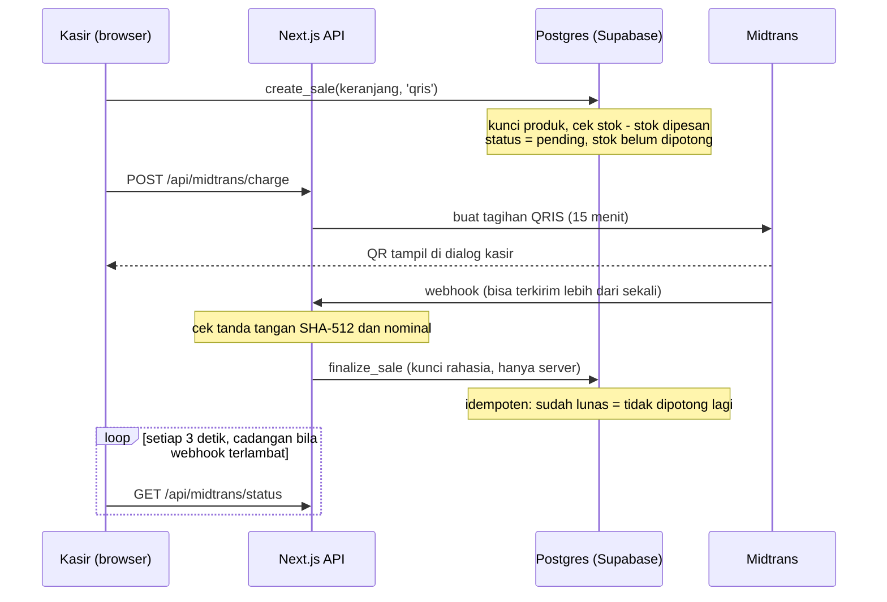

# Warung Sembako

[](https://github.com/RiskiWahyuSaputra/warung-sembako/actions/workflows/ci.yml)

Aplikasi kasir dan stok untuk warung sembako: bensin eceran, gas, galon, rokok, beras curah, dan barang harian.
Dibuat dengan Next.js 16 + Supabase, pembayaran QRIS lewat Midtrans.

## Fitur

- **Kasir**: scan barcode (scanner USB atau kamera HP), keranjang, bayar tunai / QRIS / kasbon, cetak struk 58mm.
- **Satuan jual fleksibel**: rokok per batang, bungkus, atau slop; bensin per liter atau per nominal (Rp10.000); beras per kg.
- **Tukar wadah**: jual "tukar tabung" gas atau "tukar galon" otomatis menambah stok tabung/galon kosong.
- **Stok**: barang masuk (dihitung per dus/slop, dikonversi otomatis), harga modal rata-rata, stok opname, riwayat.
- **Kasbon**: utang per pelanggan, bayar sebagian, pengingat WhatsApp.
- **Laporan** (khusus pemilik): laba kotor, omzet, per cara bayar, per hari, 10 barang terlaris.
- **Peran**: pemilik dan kasir. Kasir tidak bisa melihat harga modal, laporan laba, atau mengubah harga.

Pintasan kasir: `F2` cari barang, `F9` bayar.

## Masalah yang diselesaikan

Aplikasi kasir umum menganggap satu barang punya satu harga dan satu satuan. Warung tidak begitu:

- Rokok dibeli per slop, dijual per bungkus **dan** per batang dari stok yang sama.
- Bensin eceran sering dibeli "sepuluh ribu", bukan "satu liter".
- Pembeli gas biasanya menukar tabung kosong, jadi stok tabung kosong ikut bertambah.
- Pelanggan langganan berutang (kasbon) dan membayar dicicil.
- Kasir tidak boleh tahu harga modal, dan tidak boleh bisa "mengakali" stok.

## Keputusan teknis

**Stok dalam satuan dasar.** Setiap barang punya satu satuan dasar (batang, liter, gram) dan beberapa satuan jual
dengan faktor konversi (Bungkus = 16 batang). Stok, riwayat, dan harga modal selalu dihitung dalam satuan dasar,
jadi menjual per bungkus dan per batang tidak pernah membuat stok selisih.

**Semua tulisan lewat fungsi database.** Browser tidak bisa menulis ke tabel penjualan, stok, atau kasbon. Kasir
memanggil `create_sale`, fungsi Postgres yang dalam satu transaksi: mengambil harga dari database (bukan dari browser),
mengecek stok, membuat struk, memotong stok, dan mencatat riwayat. Kalau satu langkah gagal, semuanya batal.

**Batasan peran di database, bukan di tampilan.** Row Level Security dan hak per kolom membuat kasir secara teknis
tidak bisa membaca `cost_price` atau mengubah stok, bahkan lewat API Supabase langsung. Menyembunyikan tombol saja tidak cukup.

**QRIS tanpa stok minus.** Pembayaran QRIS bersifat asinkron, dan uang yang sudah masuk tidak boleh ditolak.
Karena itu stok baru dipotong saat lunas, tapi barang di tagihan yang belum dibayar dihitung sebagai stok yang sudah
dipesan, dan baris produk dikunci saat dicek supaya dua kasir tidak bisa menjual barang terakhir bersamaan.



**Webhook tidak dipercaya begitu saja.** Tanda tangan dicek dengan `timingSafeEqual`, nominal dicocokkan dengan total
di database, dan `finalize_sale` hanya bisa dipanggil server. Webhook yang datang dua kali tidak memotong stok dua kali.

## Setup

### 1. Supabase

1. Buat project di [supabase.com](https://supabase.com).
2. Buka **SQL Editor**, jalankan isi `supabase/schema.sql`.
   Kalau database sudah dibuat dari versi lama, jalankan file `supabase/update-*.sql` yang belum pernah dijalankan, berurutan dari nomor terkecil.
3. (Opsional) jalankan `supabase/seed.sql` untuk data contoh. Harganya hanya contoh, ubah sesuai warung kamu.
4. Buka **Authentication > Users > Add user**, buat akun pemilik dulu.
   **Pengguna pertama otomatis jadi pemilik**, akun berikutnya jadi kasir.
5. Matikan pendaftaran publik di **Authentication > Sign In / Providers > Allow new users to sign up**,
   supaya hanya pemilik yang bisa menambah akun.

#### Akun tester (staging)

Buat akun pemilik/admin untuk tester tanpa lewat dashboard Supabase:

```bash
npm run akun:tester -- tester@warung.test              # kata sandi acak, dicetak di terminal
npm run akun:tester -- tester@warung.test Rahasia123   # kata sandi sendiri
npm run akun:tester -- kasir@warung.test --kasir       # akun kasir
node --env-file=.env.staging scripts/akun-tester.mjs tester@warung.test   # database staging
```

Skrip memakai `SUPABASE_SECRET_KEY` dan aman dijalankan ulang: akun yang sudah ada diperbarui kata sandi dan perannya.

### 2. Midtrans (QRIS)

1. Daftar di [dashboard.midtrans.com](https://dashboard.midtrans.com), pakai mode **Sandbox** dulu.
2. Pastikan **Other QRIS** aktif di **Settings > Snap Checkout > Payment methods**.
3. Di **Settings > Access Keys**, buat server key dengan izin:
   - **Snap Checkout: Write** (membuat halaman QRIS)
   - **Core API: Write** (cek status pembayaran)
   - **Cancel transaction: Write** (tombol "Batalkan QRIS")
4. Salin **server key** ke `MIDTRANS_SERVER_KEY` dan **client key** ke `NEXT_PUBLIC_MIDTRANS_CLIENT_KEY`.
5. Setelah aplikasi online, isi **Settings > Payment > Notification URL** dengan
   `https://domain-kamu/api/midtrans/notification`.

QRIS tampil lewat halaman Snap yang ditanam di dialog kasir (`MIDTRANS_QRIS_MODE=snap`).
Kalau Midtrans sudah mengaktifkan Core API untuk akunmu, `MIDTRANS_QRIS_MODE=core` menampilkan gambar QR langsung.

Selama development di localhost, webhook Midtrans tidak bisa menjangkau komputer kamu.
Tidak masalah: layar kasir mengecek status pembayaran ke Midtrans setiap 3 detik.
Untuk mencoba bayar di sandbox, buka [simulator QRIS Midtrans](https://simulator.sandbox.midtrans.com/v2/qris/index)
dan tempel URL gambar QR yang muncul.

### 3. Jalankan

```bash
cp .env.example .env.local   # lalu isi nilainya
npm install
npm run dev
```

Buka http://localhost:3000 dan masuk dengan akun pemilik.

## Tes

```bash
npm test            # 61 tes, ~20 detik
npm run typecheck
npm run lint
```

- **Tes database** (`tests/db`) menjalankan `supabase/schema.sql` asli di [PGlite](https://pglite.dev) (Postgres di WASM),
  jadi tidak butuh Supabase, Docker, atau internet. Yang diuji: stok berkurang dalam satuan dasar, transaksi batal utuh
  bila stok kurang, bensin per nominal, tukar tabung, kasbon, webhook QRIS ganda, harga modal rata-rata, laporan,
  dan batasan kasir lewat RLS (tidak bisa melihat modal, mengubah stok, atau menandai QRIS lunas sendiri).
- **Tes unit** (`tests/unit`): hitung keranjang, format angka Indonesia, verifikasi tanda tangan webhook Midtrans.

Semua tes, lint, typecheck, dan build berjalan otomatis di GitHub Actions setiap push.

## Catatan

- **Kamera** untuk scan barcode hanya jalan di HTTPS atau `localhost`. Untuk mencoba dari HP di jaringan yang sama,
  deploy dulu (mis. Vercel) atau pakai tunnel HTTPS.
- **Printer thermal**: tombol "Cetak struk" membuka dialog cetak browser dengan ukuran kertas 58mm.
  Pasang printer Bluetooth/USB sebagai printer di sistem operasi.
- **Stok** disimpan dalam satuan dasar (batang, liter, gram, pcs). Semua perubahan stok tercatat di `stock_movements`.
- **Keamanan**: penjualan, stok, dan kasbon hanya bisa diubah lewat fungsi database (RPC), bukan langsung dari browser.
  `SUPABASE_SECRET_KEY` dan `MIDTRANS_SERVER_KEY` hanya dipakai di server; jangan beri awalan `NEXT_PUBLIC_`.
